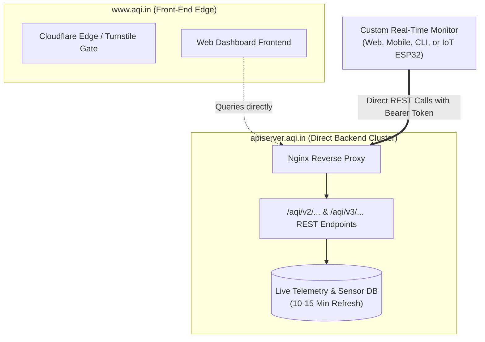

# AQI.in Real-Time Air Quality Monitor — Reverse Engineering & API Documentation

> **Target Platform:** [AQI.in](https://www.aqi.in)  
> **Source Dashboard:** `https://www.aqi.in/in/dashboard/india/delhi`  
> **Backend Base URL:** `https://apiserver.aqi.in`  
> **Protocol:** REST over HTTPS  
> **Auth Scheme:** HTTP Bearer Token (HS256 JWT)  
> **Document Version:** 1.0.0  

---

## 1. Executive Summary & Architectural Overview

The AQI.in platform renders air quality metrics, pollutant concentrations, and local meteorological observations on `www.aqi.in`. While the public-facing web pages are shielded behind Cloudflare bot protections, the client-side Single Page Application (SPA) retrieves telemetry directly from an unshielded backend REST service at `https://apiserver.aqi.in`.

This documentation details the reverse-engineered endpoints, payload schemas, query parameters, authentication lifecycle, and full implementation templates required to build a standalone, real-time AQI monitor.



---

## 2. Authentication & Authorization

All requests to `https://apiserver.aqi.in` require a JSON Web Token (JWT) supplied via standard HTTP headers:

```http
Authorization: Bearer <TOKEN>
User-Agent: Mozilla/5.0 (Windows NT 10.0; Win64; x64) AppleWebKit/537.36
```

### JWT Structure & Claims
* **Header:**
  ```json
  {
    "alg": "HS256",
    "typ": "JWT"
  }
  ```
* **Payload:**
  ```json
  {
    "userID": 1,
    "phpUserId": 1,
    "iat": 1794224319,
    "exp": 1794829119
  }
  ```
* **Token Lifetime:** 604,800 seconds (7 days).

### 2.1. Zero-Touch Automatic Token Refresh (Permanent Autonomy)

**You do NOT need to manually copy or replace tokens every 7 days.**

When AQI.in renders its public landing page (`https://www.aqi.in`), its server-side rendering (SSR) engine generates a fresh 7-day visitor JWT token and embeds it directly into the initial HTML document within `siteStore.token2`.

Your application can automatically fetch, extract, and renew its own token programmatically at startup or whenever an HTTP `401 Unauthorized` status is detected:

```python
import urllib.request, re, json, base64

def fetch_fresh_token() -> str:
    """Auto-refreshes and returns a fresh 7-day token directly from aqi.in."""
    headers = {
        'User-Agent': 'Mozilla/5.0 (Windows NT 10.0; Win64; x64) AppleWebKit/537.36 (KHTML, like Gecko) Chrome/120.0.0.0 Safari/537.36',
        'Accept': 'text/html,application/xhtml+xml,application/xml;q=0.9,*/*;q=0.8'
    }
    req = urllib.request.Request('https://www.aqi.in', headers=headers)
    with urllib.request.urlopen(req, timeout=12) as resp:
        html = resp.read().decode('utf-8', errors='ignore')
        matches = re.findall(r'ey[A-Za-z0-9_-]+\.ey[A-Za-z0-9_-]+\.[A-Za-z0-9_-]+', html)
        for token in matches:
            try:
                part = token.split('.')[1]
                part += '=' * ((4 - len(part) % 4) % 4)
                claims = json.loads(base64.urlsafe_b64decode(part).decode())
                if 'userID' in claims:
                    return token
            except Exception:
                continue
    raise RuntimeError("Failed to auto-extract fresh AQI visitor token")
```

---

## 3. Parameter Mapping Reference

### Slug Depth & `type` Enumeration
The `type` query parameter informs the backend router of the administrative hierarchy:

| Value | Level | Example Slug | Scope |
| :---: | :--- | :--- | :--- |
| `1` | Country | `india` | National index |
| `2` | State | `india/delhi` | State / Territory composite |
| `3` | City | `india/delhi/new-delhi` | City-wide composite index |
| `4` | Station | `india/delhi/new-delhi/puth-khurd` | Specific physical monitoring sensor |

---

## 4. Reverse-Engineered Endpoints

### 4.1. Real-Time City Telemetry & Weather
Retrieves the overall live index, comprehensive pollutant breakdown, and real-time weather metrics for a city.

* **HTTP Method:** `GET`
* **Route:** `/aqi/v2/getLocationDetailsBySlug`
* **Full URL:** `https://apiserver.aqi.in/aqi/v2/getLocationDetailsBySlug?slug=india/delhi/new-delhi&type=3&source=web`
* **Headers:** `Authorization: Bearer <TOKEN>`
* **Parameters:**
  * `slug` (*string, required*): Location slug (e.g. `india/delhi/new-delhi`).
  * `type` (*integer, required*): `3` for city level.
  * `source` (*string, required*): `web`.

#### Sample Response Body
```json
{
  "status": "success",
  "message": "Data found",
  "data": [
    {
      "uid": "11267",
      "city": "New Delhi",
      "state": "Delhi",
      "country": "India",
      "station": "Puth Khurd, New Delhi, Delhi, India",
      "latitude": 28.6325,
      "longitude": 77.2205,
      "time_zone": "Asia/Kolkata",
      "updated_at": "2026-11-09T17:21:02.000Z",
      "isOnline": true,
      "iaqi": {
        "AQI-IN": 299,
        "aqi": 203,
        "pm25": 127,
        "pm10": 141,
        "co": 994,
        "no2": 12,
        "so2": 7,
        "o3": 18
      },
      "weather": {
        "temp_c": 26.1,
        "temp_f": 79.0,
        "feelslike_c": 26.7,
        "humidity": 50,
        "pressure_mb": 1016,
        "vis_km": 6.4,
        "wind_kph": 5.4,
        "wind_dir": "NE",
        "wind_degree": 50,
        "uv": 0,
        "condition": {
          "text": "Smoky haze",
          "icon": "https://apiserver.aqi.in/uploads/weather-icons/15.svg",
          "code": 1036
        }
      }
    }
  ]
}
```

---

### 4.2. Nearby Stations Geolocation Radius Feed
Locates the closest physical monitoring stations around specified coordinates.

* **HTTP Method:** `GET`
* **Route:** `/aqi/v2/getNearestLocation`
* **Full URL:** `https://apiserver.aqi.in/aqi/v2/getNearestLocation?lat=28.6325&long=77.2205&type=1&source=web`
* **Parameters:**
  * `lat` (*float, required*): Target latitude.
  * `long` (*float, required*): Target longitude.
  * `type` (*integer, required*): `1` returns the 5 closest neighborhood stations; `2` returns the anchor station.
  * `source` (*string, required*): `web`.

#### Sample Output Items
```json
[
  {
    "station": "Connaught Place, New Delhi, Delhi, India",
    "location_slug": "india/delhi/new-delhi/connaught-place",
    "latitude": 28.6289,
    "longitude": 77.2065,
    "iaqi": { "AQI-IN": 309, "pm25": 132 }
  },
  {
    "station": "HT House, New Delhi, Delhi, India",
    "location_slug": "india/delhi/new-delhi/ht-house",
    "latitude": 28.6258,
    "longitude": 77.2185,
    "iaqi": { "AQI-IN": 309, "pm25": 132 }
  },
  {
    "station": "Todermal Road Area, New Delhi, Delhi, India",
    "location_slug": "india/delhi/new-delhi/todermal-road-area",
    "latitude": 28.6291,
    "longitude": 77.2294,
    "iaqi": { "AQI-IN": 315, "pm25": 139 }
  }
]
```

---

### 4.3. Specific Station / Sensor Pinpoint
To query telemetry for a specific individual monitoring station:

* **HTTP Method:** `GET`
* **Route:** `/aqi/v2/getLocationDetailsBySlug`
* **Full URL:** `https://apiserver.aqi.in/aqi/v2/getLocationDetailsBySlug?slug=india/delhi/new-delhi/connaught-place&type=4&source=web`
* **Parameters:**
  * `slug` (*string*): Station slug (e.g. `india/delhi/new-delhi/connaught-place`).
  * `type` (*integer*): `4` (Station level).
  * `source` (*string*): `web`.

---

### 4.4. 24-Hour Hourly Trend (Sparklines & Charts)
Provides time-series arrays formatted for rendering trend lines.

* **HTTP Method:** `GET`
* **Route:** `/aqi/v3/getLast24HourHistory`
* **Full URL:** `https://apiserver.aqi.in/aqi/v3/getLast24HourHistory?slug=india/delhi/new-delhi&sensorname=AQI-IN&slugType=cityId&source=web`
* **Parameters:**
  * `slug` (*string*): Location slug.
  * `sensorname` (*string*): `AQI-IN` (or individual pollutant like `pm25`).
  * `slugType` (*string*): `cityId`.
  * `source` (*string*): `web`.

#### Response Keys
* `data.timeArray`: List of hourly timestamps over the last 24 hours.
* `data.averageArray`: List of corresponding AQI index measurements.
* `data.minValue`: Minimum recorded value in the period.
* `data.maxValue`: Maximum recorded value in the period.
* `data.avgValue`: Average value across the period.

---

### 4.5. Historical Daily Calendar
Aggregates daily mean AQI ratings across months and years.

* **HTTP Method:** `GET`
* **Route:** `/aqi/v2/getAqiCalender`
* **Full URL:** `https://apiserver.aqi.in/aqi/v2/getAqiCalender?slug=india/delhi/new-delhi&slugType=cityId&sensorname=AQI-IN&source=web`
* **Parameters:**
  * `slug` (*string*): Location slug.
  * `slugType` (*string*): `cityId`.
  * `sensorname` (*string*): `AQI-IN`.
  * `source` (*string*): `web`.

---

### 4.6. City / Country Rankings
Fetches current rankings of most/least polluted locations.

* **HTTP Method:** `GET`
* **Route:** `/aqi/getAirQualityRanklistCountryAndCity`
* **Full URL:** `https://apiserver.aqi.in/aqi/getAirQualityRanklistCountryAndCity?sensorname=AQI-IN&type=2&limit=10&source=web`
* **Parameters:**
  * `sensorname` (*string*): `AQI-IN`.
  * `type` (*integer*): `1` for Countries, `2` for Cities.
  * `limit` (*integer*): Maximum number of entries (e.g. `10`).

---

### 4.7. Location Search Autocomplete
Searches for location slugs by city, state, or country name.

* **HTTP Method:** `GET`
* **Route:** `/aqi/searchLocationCityStateCountry`
* **Full URL:** `https://apiserver.aqi.in/aqi/searchLocationCityStateCountry?searchString=delhi&source=web`

---

## 5. Data Model & Field Reference

### Pollutant Index (`iaqi`)
| Key | Metric | Unit | Standard / Description |
| :--- | :--- | :--- | :--- |
| `AQI-IN` | Air Quality Index | Index (0–500+) | CPCB Indian National AQI Standard |
| `aqi` | Air Quality Index | Index (0–500+) | US EPA Standard Equivalent |
| `pm25` | Fine Particulate Matter | µg/m³ | Particles $\le$ 2.5 micrometers |
| `pm10` | Coarse Particulate Matter | µg/m³ | Particles $\le$ 10 micrometers |
| `no2` | Nitrogen Dioxide | ppb / µg/m³ | Combustion emissions |
| `so2` | Sulfur Dioxide | ppb / µg/m³ | Industrial emissions |
| `co` | Carbon Monoxide | ppm / µg/m³ | Incomplete combustion |
| `o3` | Ground-level Ozone | ppb / µg/m³ | Photochemical smog |

### Weather Attributes (`weather`)
| Key | Type | Description |
| :--- | :--- | :--- |
| `temp_c` / `temp_f` | float | Ambient temperature in Celsius and Fahrenheit |
| `feelslike_c` | float | Perceived temperature |
| `humidity` | integer | Relative humidity percentage (%) |
| `pressure_mb` | integer | Barometric atmospheric pressure in millibars |
| `vis_km` | float | Visual atmospheric range in kilometers |
| `wind_kph` | float | Wind speed in km/h |
| `wind_dir` | string | Compass direction (e.g., `NE`, `WNW`) |
| `wind_degree` | integer | Wind azimuth degrees (0–360°) |
| `uv` | integer | Ultraviolet index value |
| `condition.text` | string | Sky summary (e.g. `Smoky haze`, `Clear`, `Haze`) |
| `condition.icon` | string | Direct SVG asset URL hosted on `apiserver.aqi.in` |

---

## 6. Indian National AQI (CPCB) Standard Scale

| AQI Band | Category | Hex Color | Health Impact |
| :---: | :---: | :---: | :--- |
| **0 – 50** | Good | `#009966` | Minimal impact. |
| **51 – 100** | Satisfactory | `#ffde33` | Minor breathing discomfort to sensitive people. |
| **101 – 200** | Moderate | `#ff9933` | Breathing discomfort to people with lungs, asthma, and heart diseases. |
| **201 – 300** | Poor | `#cc0033` | Breathing discomfort to most people on prolonged exposure. |
| **301 – 400** | Very Poor | `#660099` | Respiratory illness on prolonged exposure. |
| **401 – 500+** | Severe | `#7e0023` | Affects healthy people and seriously impacts those with existing diseases. |

---

## 7. Production Integration Implementations

### 7.1. Python Real-Time Poller & CLI Dashboard (`monitor.py`)

```python
"""
Real-Time AQI Monitor Client
Reverse-engineered from aqi.in backend APIs.
"""

import os
import sys
import time
import re
import json
import base64
from datetime import datetime
import requests

API_BASE = "https://apiserver.aqi.in"

class AQISession:
    """Manages live token lifecycle with automatic zero-touch self-renewal."""
    def __init__(self, initial_token: str = None):
        self.token = initial_token or os.getenv("AQI_BEARER_TOKEN")
        if not self.token:
            self.refresh_token()

    def refresh_token(self) -> str:
        print("[AUTH] Fetching fresh 7-day token from aqi.in SSR bootstrap...")
        headers = {
            "User-Agent": "Mozilla/5.0 (Windows NT 10.0; Win64; x64) AppleWebKit/537.36 (KHTML, like Gecko) Chrome/120.0.0.0 Safari/537.36",
            "Accept": "text/html,application/xhtml+xml,application/xml;q=0.9,*/*;q=0.8"
        }
        res = requests.get("https://www.aqi.in", headers=headers, timeout=12)
        res.raise_for_status()
        tokens = re.findall(r'ey[A-Za-z0-9_-]+\.ey[A-Za-z0-9_-]+\.[A-Za-z0-9_-]+', res.text)
        for t in tokens:
            try:
                part = t.split('.')[1]
                part += '=' * ((4 - len(part) % 4) % 4)
                claims = json.loads(base64.urlsafe_b64decode(part).decode())
                if "userID" in claims:
                    self.token = t
                    print("[AUTH] Successfully acquired new token! Expires in 7 days.")
                    return self.token
            except Exception:
                continue
        raise RuntimeError("Failed to extract visitor token from HTML.")

    def get_headers(self) -> dict:
        return {
            "Authorization": f"Bearer {self.token}",
            "User-Agent": "Mozilla/5.0 (Windows NT 10.0; Win64; x64) AppleWebKit/537.36"
        }

session = AQISession()
DELHI_SLUG = "india/delhi/new-delhi"
DELHI_COORDS = {"lat": 28.6325, "long": 77.2205}

def get_aqi_badge(aqi_val: int):
    if aqi_val <= 50: return ("Good", "\033[92m")
    if aqi_val <= 100: return ("Satisfactory", "\033[93m")
    if aqi_val <= 200: return ("Moderate", "\033[33m")
    if aqi_val <= 300: return ("Poor", "\033[91m")
    if aqi_val <= 400: return ("Very Poor", "\033[35m")
    return ("Severe", "\033[31m")

def get_live_city_telemetry(slug: str):
    url = f"{API_BASE}/aqi/v2/getLocationDetailsBySlug"
    params = {"slug": slug, "type": 3, "source": "web"}
    try:
        res = requests.get(url, headers=session.get_headers(), params=params, timeout=12)
        if res.status_code == 401:
            session.refresh_token()
            res = requests.get(url, headers=session.get_headers(), params=params, timeout=12)
        res.raise_for_status()
        payload = res.json()
        if payload.get("status") == "success" and payload.get("data"):
            return payload["data"][0]
    except Exception as e:
        print(f"[API Error] get_live_city_telemetry: {e}")
    return None

def get_nearby_stations(lat: float, lon: float):
    url = f"{API_BASE}/aqi/v2/getNearestLocation"
    params = {"lat": lat, "long": lon, "type": 1, "source": "web"}
    try:
        res = requests.get(url, headers=session.get_headers(), params=params, timeout=12)
        if res.status_code == 401:
            session.refresh_token()
            res = requests.get(url, headers=session.get_headers(), params=params, timeout=12)
        res.raise_for_status()
        return res.json().get("data", [])
    except Exception as e:
        print(f"[API Error] get_nearby_stations: {e}")
        return []

def run_dashboard_tick():
    try:
        city_data = get_live_city_telemetry(DELHI_SLUG)
        if not city_data:
            print("[WARN] Received empty payload from API server.")
            return

        iaqi = city_data.get("iaqi", {})
        weather = city_data.get("weather", {})
        aqi_in = iaqi.get("AQI-IN", 0)
        label, color = get_aqi_badge(aqi_in)
        rst = "\033[0m"

        print("\n" + "=" * 68)
        print(f"  REAL-TIME AQI MONITOR  |  {datetime.now().strftime('%Y-%m-%d %H:%M:%S')}")
        print("=" * 68)
        print(f" Location       : {city_data.get('city')}, {city_data.get('state')} ({city_data.get('station')})")
        print(f" Sensor Status  : {'ONLINE' if city_data.get('isOnline') else 'OFFLINE'} | Updated: {city_data.get('updated_at')}")
        print(f" AQI (IN Standard) : {color}{aqi_in} [{label}]{rst}")
        print(f" AQI (US EPA)      : {iaqi.get('aqi')}")
        print("-" * 68)
        print(" POLLUTANTS BREAKDOWN (µg/m³):")
        print(f"   PM2.5 : {iaqi.get('pm25'):<6} | PM10  : {iaqi.get('pm10'):<6} | NO2 : {iaqi.get('no2')}")
        print(f"   CO    : {iaqi.get('co'):<6} | SO2   : {iaqi.get('so2'):<6} | O3  : {iaqi.get('o3')}")
        print("-" * 68)
        print(" CURRENT WEATHER OBSERVATIONS:")
        print(f"   Temperature : {weather.get('temp_c')} °C (Feels like: {weather.get('feelslike_c')} °C)")
        print(f"   Humidity    : {weather.get('humidity')} %  | Pressure : {weather.get('pressure_mb')} mb")
        print(f"   Wind        : {weather.get('wind_kph')} kph ({weather.get('wind_dir')}) | Visibility: {weather.get('vis_km')} km")
        print(f"   Sky Condition: {weather.get('condition', {}).get('text')}")
        print("-" * 68)

        stations = get_nearby_stations(DELHI_COORDS["lat"], DELHI_COORDS["long"])
        print(" LOCAL NEIGHBORHOOD STATIONS:")
        for st in stations:
            st_name = st.get('station', '').split(',')[0]
            st_aqi = st.get('iaqi', {}).get('AQI-IN', 'N/A')
            st_pm25 = st.get('iaqi', {}).get('pm25', 'N/A')
            print(f"   • {st_name:<28} -> AQI: {st_aqi:<4} | PM2.5: {st_pm25} µg/m³")
        print("=" * 68)

    except requests.exceptions.HTTPError as err:
        if err.response.status_code == 401:
            print("[CRITICAL] Bearer Token expired (401 Unauthorized). Update token.", file=sys.stderr)
        else:
            print(f"[ERROR] HTTP request failed: {err}", file=sys.stderr)
    except Exception as ex:
        print(f"[ERROR] Unexpected polling error: {ex}", file=sys.stderr)

if __name__ == "__main__":
    run_dashboard_tick()
```

---

### 7.2. TypeScript / Node.js Real-Time Service (`aqiService.ts`)

```typescript
import axios from 'axios';

const API_BASE = 'https://apiserver.aqi.in';
let currentToken = process.env.AQI_BEARER_TOKEN || '';

/**
 * Automatically fetch a fresh 7-day token directly from aqi.in HTML
 */
export async function refreshAQIToken(): Promise<string> {
  const { data: html } = await axios.get('https://www.aqi.in', {
    headers: {
      'User-Agent': 'Mozilla/5.0 (Windows NT 10.0; Win64; x64) AppleWebKit/537.36 (KHTML, like Gecko) Chrome/120.0.0.0 Safari/537.36'
    }
  });

  const matches = html.match(/ey[A-Za-z0-9_-]+\.ey[A-Za-z0-9_-]+\.[A-Za-z0-9_-]+/g) || [];
  for (const token of matches) {
    try {
      const payloadSegment = token.split('.')[1].replace(/-/g, '+').replace(/_/g, '/');
      const claims = JSON.parse(Buffer.from(payloadSegment, 'base64').toString('utf8'));
      if (claims.userID) {
        currentToken = token;
        return token;
      }
    } catch {
      continue;
    }
  }
  throw new Error('Failed to auto-refresh AQI visitor token');
}

const aqiClient = axios.create({
  baseURL: API_BASE,
  timeout: 10000
});

// Automatic token attachment and 401 recovery interceptor
aqiClient.interceptors.request.use(async (config) => {
  if (!currentToken) await refreshAQIToken();
  config.headers.Authorization = `Bearer ${currentToken}`;
  config.headers['User-Agent'] = 'Mozilla/5.0 (Windows NT 10.0; Win64; x64)';
  return config;
});

aqiClient.interceptors.response.use(
  (response) => response,
  async (error) => {
    if (error.response?.status === 401 && !error.config._retry) {
      error.config._retry = true;
      await refreshAQIToken();
      error.config.headers.Authorization = `Bearer ${currentToken}`;
      return aqiClient(error.config);
    }
    return Promise.reject(error);
  }
);

export interface IAQIMetrics {
  'AQI-IN': number;
  aqi: number;
  pm25: number;
  pm10: number;
  co: number;
  no2: number;
  so2: number;
  o3: number;
}

export interface WeatherMetrics {
  temp_c: number;
  feelslike_c: number;
  humidity: number;
  pressure_mb: number;
  vis_km: number;
  wind_kph: number;
  wind_dir: string;
  condition: {
    text: string;
    icon: string;
    code: number;
  };
}

export interface CityData {
  city: string;
  state: string;
  country: string;
  station: string;
  updated_at: string;
  iaqi: IAQIMetrics;
  weather: WeatherMetrics;
}

/**
 * Fetch real-time city telemetry
 */
export async function getLiveCityTelemetry(slug: string = 'india/delhi/new-delhi'): Promise<CityData> {
  const response = await aqiClient.get('/aqi/v2/getLocationDetailsBySlug', {
    params: { slug, type: 3, source: 'web' }
  });
  return response.data.data[0];
}

/**
 * Fetch nearby monitoring sensors
 */
export async function getNearbyStations(lat: number = 28.6325, long: number = 77.2205) {
  const response = await aqiClient.get('/aqi/v2/getNearestLocation', {
    params: { lat, long, type: 1, source: 'web' }
  });
  return response.data.data;
}

/**
 * Fetch 24-hour hourly trend history for charting
 */
export async function getLast24HoursTrend(slug: string = 'india/delhi/new-delhi') {
  const response = await aqiClient.get('/aqi/v3/getLast24HourHistory', {
    params: { slug, sensorname: 'AQI-IN', slugType: 'cityId', source: 'web' }
  });
  return response.data.data;
}
```

---

## 8. Monitor Architecture Recommendations

### A. Web Application (React / Next.js / Tailwind CSS)
* **Gauges & Radial Bars:** Use `@tremor/react` or `recharts` for radial gauge meters displaying `AQI-IN` colored according to the CPCB hex palette.
* **Sparklines:** Hook the `/aqi/v3/getLast24HourHistory` `timeArray` and `averageArray` to lightweight line charts.
* **Map View:** Render Mapbox or Leaflet pins with coordinates and AQI values returned by `/aqi/v2/getNearestLocation`.

### B. Hardware / IoT Display (ESP32 / Raspberry Pi)
* **Display Types:** Waveshare 2.9" / 4.2" E-Paper or SSD1306 OLED.
* **Cycle:** Wake from deep sleep every 15 minutes, perform Wi-Fi connection, query `/aqi/v2/getLocationDetailsBySlug`, parse JSON with ArduinoJson, update the display buffer, and return to deep sleep to conserve battery.

### C. Server-Side Caching & Rate Protection
* Maintain an in-memory or Redis cache with a **Time-To-Live (TTL) of 300 seconds (5 minutes)**. Stations update approximately every 10–15 minutes, making sub-minute polling redundant.
